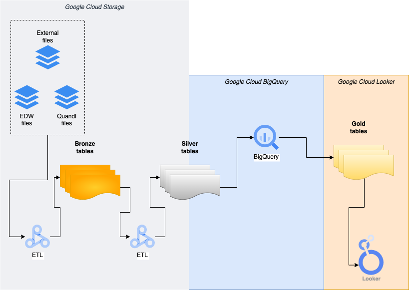

# LES ETL pipeline

A bronze/silver lakehouse ETL for leasing financial data, built for **GCP
Dataproc Serverless for Apache Spark** with **Delta Lake**.

The pipeline ingests raw provider files (CSV and XML), validates and profiles
them, applies SCD-2 history, and produces normalized silver tables ready for BI
and feature engineering.

## Schema



## Main design

- **Bronze layer**: one-to-one copy of the raw file, profiled with a lower level
  of rules and extended with SCD-2 columns (`valid_from`, `valid_to`,
  `iscurrent`, `checksum`, `part`).
- **Silver layer**: normalized data from the previous layer, with dimensions
  separated and values cast to their final types.
- **Gold layer**: business metrics and ML features, produced outside this repo
  (Looker Studio, Dataproc Serverless or DataFlow).

Profiling rules live in `src/les_etl_pipeline/utils/validation_rules.py` and are
enforced with [Cerberus](https://docs.python-cerberus.org/): primary keys are
unique and complete, tables are not empty, non-nullable columns are populated,
and compulsory columns are present.

## What you can run without GCP

Everything below runs locally, offline, on synthetic fixtures:

```bash
poetry install
make demo        # bronze -> silver on tests/fixtures, writes to local_data/
poetry run pytest
```

`make demo` needs **Python 3.9 or 3.10** and **Java 11+** (Spark requirement).
It exercises the real parsing, profiling, casting and SCD-2 code paths against
`tests/fixtures/`; it does not touch GCS, BigQuery or Dataproc.

## What needs GCP

- Reading raw files from GCS and writing Delta tables back to GCS.
- Uploading the packaged code and JARs to the code bucket (`make build`).
- Running the Airflow DAGs on Cloud Composer, which submit Dataproc Serverless
  batches.

Those paths require credentials for a project you control. They are not
reproducible against the original private project, by design.

## Configuration

All runtime settings come from environment variables. Copy the template and
fill it in:

```bash
cp .env.example .env
```

| Variable | Required | Default | Purpose |
|---|---|---|---|
| `GCP_PROJECT_ID` | yes | — | Project that owns buckets and Dataproc resources |
| `GCP_REGION` | no | `europe-west3` | Dataproc region |
| `CODE_BUCKET` | no | `data-lake-code-v2-<project-number>` | Packaged code and JARs |
| `RAW_BUCKET` | no | `my_data` | Raw provider files |
| `DATA_BUCKET` | no | `my_data_lake_v2` | Bronze/silver tables |
| `PHS_BUCKET` | no | `spark-hist-repo-<project-number>` | Spark history server |
| `PHS_CLUSTER` | no | `spark-hist-srv-<project-id>` | History server cluster |
| `METASTORE_SERVICE` | no | `data-catalog-<project-id>` | Dataproc Metastore |
| `GOOGLE_APPLICATION_CREDENTIALS` | no | ambient | Service-account key for local runs |

The ETL reads these through `src/les_etl_pipeline/utils/config.py`. The DAGs read
the same names directly from the environment so Airflow can inject them.

## Deployment

```bash
export GCP_PROJECT_ID=your-project
make setup        # create code bucket and Hive Metastore
make build        # package code, fetch JARs, upload to CODE_BUCKET
```

Then upload the desired file from `dags/` to Cloud Composer and trigger the DAG.
The DAGs are `LES_dag_assets.py`, `LES_dag_bond_info.py` and
`LES_dag_deal_detail.py`.

`make build` downloads the pinned Spark JARs from Maven Central via
`make fetch-jars`; they are not committed to the repository.

## Tests

```bash
poetry run pytest            # offline unit tests (local Spark + Delta)
poetry run ruff check .
```

The suite covers CSV/XML parsing, encoding cleanup, Cerberus profiling, type
casting and the SCD-2 merge (insert, update, unchanged).

## Limitations

- The DAGs are written for a specific raw-file naming convention
  (`<ed_code>_<pcd>.csv` / `.xml`); adapt `source_prefix` and `file_key` for a
  different provider.
- Silver output is parquet; only bronze uses Delta.
- The gold layer is out of scope.
- Spark 3.3 / Delta 2.1 pins are deliberate: they match the Dataproc Serverless
  runtime this pipeline was built against.

## License

[MIT](LICENSE)
